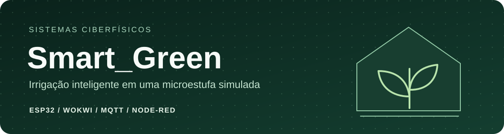
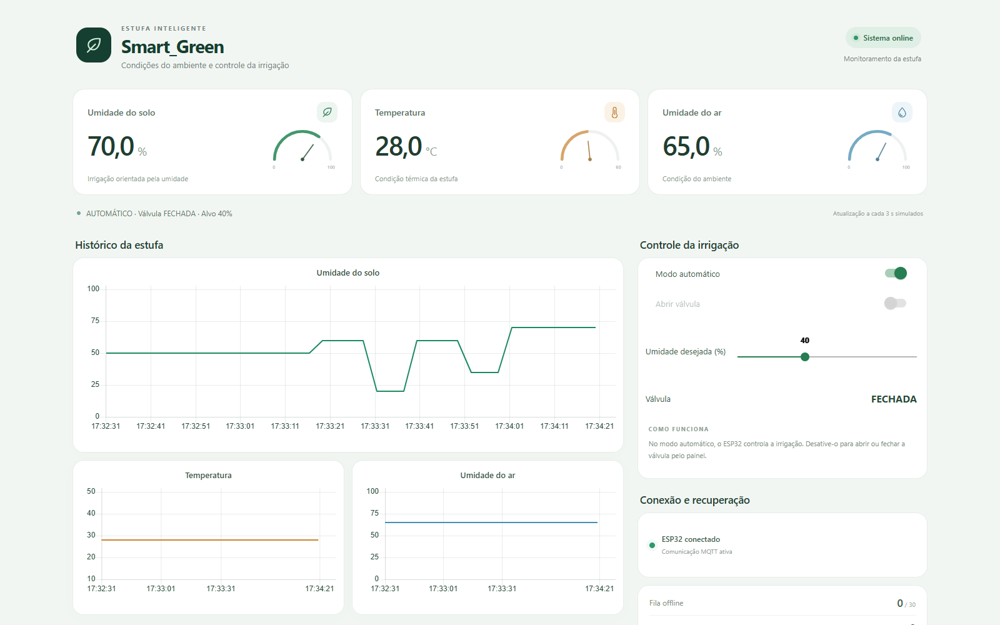

# Smart_Green

O Smart_Green monitora a umidade do solo, a temperatura e a umidade do ar de uma microestufa simulada. Um ESP32 controla a irrigação no Wokwi e envia as leituras por MQTT a um painel Node-RED. Se a conexão cair, o controle local continua e as amostras retidas são reenviadas na reconexão.

[**Abrir no Wokwi**](https://wokwi.com/projects/478798352754683905) · [**Assistir à demonstração (1min44s)**](docs/media/demonstracao.mp4) · [**Consultar o guia técnico**](docs/GUIA_TECNICO.md)

## Painel de supervisão



O painel reúne três manômetros, gráficos de histórico e comandos de irrigação. No modo automático, a válvula abre abaixo do alvo de umidade e fecha ao atingir o alvo mais 8 pontos percentuais. Também é possível alternar para o modo manual e comandar a válvula pelo painel.

## Quando a conexão cai

1. A chave **NET** simula a interrupção. O LCD sinaliza a desconexão, o LED vermelho acende e o ESP32 continua coletando dados.
2. Uma fila circular em RAM retém até **30 amostras**. Quando enche, o ESP32 descarta a mais antiga e registra o descarte.
3. Na reconexão, o Node-RED registra cada amostra no histórico e confirma seu recebimento por MQTT. O ESP32 só retira a amostra da fila após receber a confirmação. Se a confirmação se perder, o reenvio recebe outro ACK sem duplicar o ponto no histórico.
4. Enquanto o histórico é recomposto, o painel mantém a última leitura ao vivo e pausa os comandos até chegar uma nova leitura ao vivo.

O ensaio gravado recuperou **as oito amostras** coletadas durante a desconexão. [Registro do ensaio](validacao/ajustes_finais/DEMONSTRACAO_120s.json)

## Como executar

É necessário ter **Node.js 22 ou superior**, npm e acesso à internet para instalar as dependências e conectar a simulação ao broker.

1. Clone este repositório ou baixe o ZIP pelo botão **Code** do GitHub.
2. Abra o terminal na pasta do projeto e execute os comandos abaixo.
3. Acesse o [painel local](http://localhost:1880/ui/) e abra a simulação do Wokwi. Clique em **Start Simulation** para iniciar o ESP32.

```sh
cd node-red
npm ci
node node_modules/node-red/red.js --userDir . --settings settings.js flows.json
```

No Windows, também é possível usar `1_INSTALAR_PAINEL.cmd` e `2_INICIAR_PAINEL.cmd`. O atalho `INICIAR_SMART_GREEN.cmd` abre o painel e carrega a simulação automaticamente quando executado no disco D, com Chrome ou Edge instalado.

Se você executar uma cópia independente do circuito e do painel, use um prefixo MQTT próprio nos dois lados para separar as mensagens. O [guia técnico](docs/GUIA_TECNICO.md) descreve os tópicos e os arquivos envolvidos.


## Importar e exportar no Node-RED

[**Baixar o `flows.json` do Smart_Green**](https://raw.githubusercontent.com/mariomont30/Smart_Green/main/node-red/flows.json)

Em outra instalação do Node-RED, siga os passos abaixo.

1. No menu **Gerenciar paleta**, instale o pacote `node-red-dashboard` na versão `3.6.6`.
2. Abra **Importar** (`Ctrl+I`), selecione o arquivo `flows.json` e importe o fluxo em uma nova aba.
3. Clique em **Deploy** e abra o painel em `http://localhost:1880/ui/`.

O arquivo inclui os nós do painel, os controles, os gráficos e a configuração MQTT da versão do repositório. O histórico de leituras e os pacotes instalados ficam fora do arquivo.

Para exportar a configuração em uso, abra **Exportar** (`Ctrl+E`), selecione **Todos os fluxos** e clique em **Baixar**. Use essa opção quando quiser incluir todas as abas e configurações do editor. [Guia de importação e exportação do Node-RED](https://nodered.org/docs/user-guide/editor/workspace/import-export)

## Validação local

Execute o comando abaixo na raiz do repositório.

```sh
node validacao/testar-smartgreen.cjs
```

As verificações cobrem a confirmação de recebimento, a deduplicação, os dados inválidos, a preservação do histórico e o estado do painel durante o reenvio. Para reproduzir a falha de rede na simulação, siga o [roteiro da demonstração](docs/GUIA_TECNICO.md#reproduzir-a-falha-de-rede).

| Pasta | Conteúdo |
| --- | --- |
| [`wokwi/`](wokwi/) | Firmware, circuito e bibliotecas do ESP32 |
| [`node-red/`](node-red/) | Fluxo do painel e dependências fixadas |
| [`validacao/`](validacao/) | Testes de regressão, dados de ensaio e resultados |
| [`docs/`](docs/) | Guia técnico, imagens e vídeo |

Projeto acadêmico de **Sistemas Ciberfísicos Colaborativos**.
