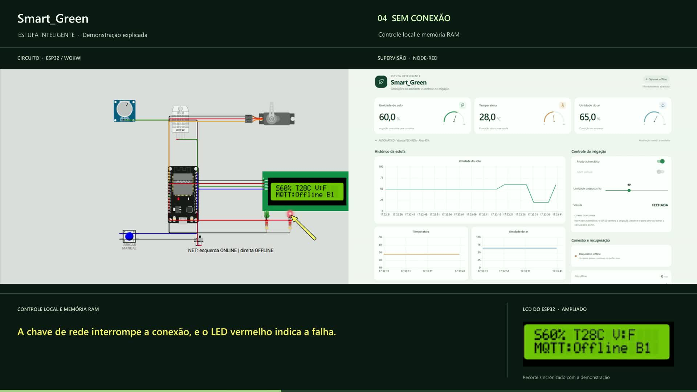
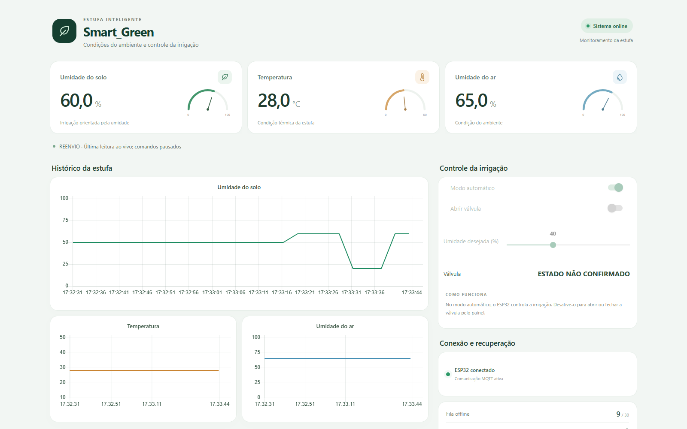

# Guia técnico do Smart_Green

## Arquitetura

O ESP32 lê os sensores e aciona o servo da válvula no Wokwi. O broker público transporta leituras, estado de conexão, comandos e confirmações. O Node-RED registra o histórico e apresenta a interface de controle em `http://localhost:1880/ui/`.

### Circuito

| Função | Componente | ESP32 |
| --- | --- | --- |
| Umidade do solo | Potenciômetro da simulação | GPIO 34 |
| Temperatura e umidade do ar | DHT22 | GPIO 18 |
| Comando local da válvula | Botão | GPIO 19 |
| Simulação de desconexão | Chave NET | GPIO 23 |
| Válvula | Servo | GPIO 13 |
| Sinalização de conexão | LEDs verde e vermelho | GPIO 26 e 27 |
| Leituras, válvula e fila | LCD I²C em `0x27` | GPIO 21 e 22 |

O [circuito](../wokwi/diagram.json), o [firmware](../wokwi/sketch.ino) e as [bibliotecas](../wokwi/libraries.txt) podem ser copiados para um novo projeto ESP32 no Wokwi.

### Comunicação MQTT

A versão empacotada usa `broker.emqx.io:1883` e o prefixo `scc/grupo_smartgreen_a8d747d1`. Em uma cópia independente, altere `BASE` no firmware e o prefixo correspondente no fluxo Node-RED antes de executar os dois lados. O broker é público e o tráfego deste protótipo usa MQTT sem TLS. Use dados simulados.

| Sufixo | Publicador | Assinante | Informação |
| --- | --- | --- | --- |
| `/telemetria` | ESP32 | Node-RED | Identificação, tempos relativos, sensores e diagnóstico |
| `/status` | ESP32 ou mensagem de última vontade do broker | Node-RED | Estado de conexão |
| `/comando` | Node-RED | ESP32 | Modo, válvula e alvo |
| `/ack` | Node-RED | ESP32 | Confirmação por dispositivo, sessão e sequência |

O firmware coleta uma amostra a cada três segundos simulados. A combinação de `device`, `boot_id` e `seq` identifica cada amostra. O histórico usa o tempo original da coleta, inclusive para dados reenviados. Se o DHT22 falhar, os valores inválidos chegam como `null`.

A fila do ESP32 guarda até 30 amostras em RAM. O histórico do Node-RED guarda até 500 pontos em memória. Reiniciar cada componente limpa a memória mantida por ele. O contador `B` no LCD representa a fila local. O contador `dropped` registra descartes por lotação.

## Reproduzir a falha de rede

1. Inicie o painel e a simulação. Aguarde as leituras e o estado conectado.
2. Ajuste a umidade do solo abaixo do alvo e observe a abertura da válvula. Aumente a leitura acima do alvo mais 8 pontos e observe o fechamento.
3. Mova **NET** para a direita. Confira a indicação de desconexão e o aumento de `B` no LCD.
4. Mova **NET** para a esquerda. Observe o reenvio, a redução da fila e a recomposição do gráfico.
5. Durante o reenvio, confira a indicação de estado não confirmado da válvula. A nova leitura ao vivo libera os controles novamente.

## Evidências

- [Demonstração gravada de 1min44s](media/demonstracao.mp4)
- [Resultado do ensaio com oito amostras offline recuperadas](../validacao/ajustes_finais/DEMONSTRACAO_120s.json)
- [Conciliação de um ensaio de reconexão com perda de ACK](../validacao/final/conciliacao-offline.json)
- [Verificações locais do fluxo](../validacao/ajustes_finais/testes.cjs)

A amostra de telemetria usada na regressão contém somente dados simulados, com identificadores de sessão normalizados e sem os horários da captura.
